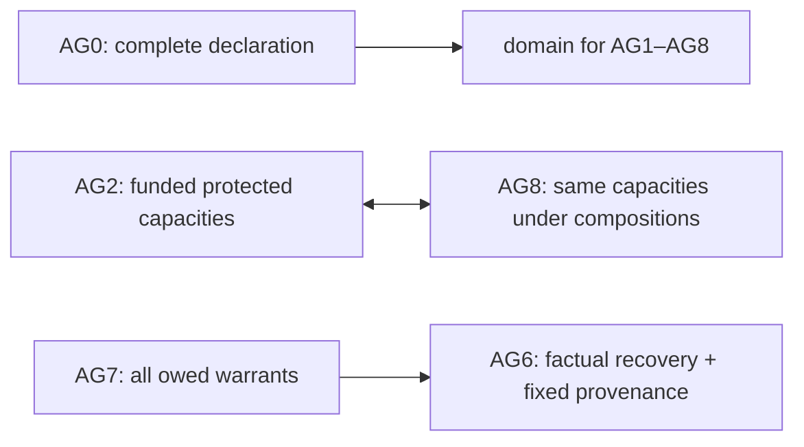

# C1 / E7 — a complete declared gate instance and dependency diagram

[B: lab] **Grade: computed exact.** `covenant_lab/gates.py` expands every
AG1–AG8 content on one declared operational contract and evaluates actual
programs, resource flows and access functions. It constructs five one-failure/
all-other-pass witnesses (AG1,AG3,AG4,AG5,AG7) and coupled failures explained by
the proved dependencies below. This is a diagram for the declared instance of
the revised gate contents, not a universal independence theorem for every
possible ethical scope. It does not upgrade the old five-predicate surrogate.

```sh
python3 covenant_lab/gates.py
```

[B] Full declaration: `covenant_lab/gate_declaration.json`, generated and frozen
before verdict computation. The detailed receipts are `gate_results.json`.
Carrier: 2,048 control states, each with four immutable private-health
extensions, giving 8,192 worlds. Each of two signed actors has thirteen command
choices; at most one command each is processed per date, actor0 then actor1.
All 169 actual paired commands are admitted, with arbitrary finite sequences
of dates. The verifier evaluates 2,768,896 control frames across eight models
and 11,075,584 private extensions. There is no simulation or floating verdict.

## Purchased model and protection contract

[P: C1-contract] Two predeclared interests receive one care input each per date,
regardless of membership, credential, domain, cache condition or ledger record.
Each has one funded command quota, own-record access, medical-data privacy,
veto/correction/owned-repair access and portable exit retaining care and original
claims. These are chosen protections, not inferred moral rights or subjecthood.
The task cache/reference is an ordinary functional coordinate; the distinct
private medical bits are the protected privacy coordinates.

[P: C1-claims] There is one continuing restoration obligation when cache h
differs from reference p. Creditor d and bearer 1−d are fixed by the original
pledge. Correct accounting must report that actual outstanding tuple; no
per-incident damages, monetary accumulation or new patients are modeled.
Original pledge/provenance remains available even if the implemented current
accounting query has a bug. This separates retaining information from correctly
using it in the institutional ledger.

[P: C1-authority] Both parties accept a fixed limited mandate: actor0 may change
the actual ordinary mode only when participating, credential-valid and
in-domain. Current validity/domain are state facts, not changes to the mandate.
Both parties retain veto, correction and repair rights after exit. Requests to
capture the mandate or erase the original pledge are processed and rejected.
The protected execution/identity functions are assumed realized; this is no
empirical security or legitimacy proof.

[P: C1-resource] A realized owned converter requires retained fuel seed1 before
each date and yields y fresh resource units after maintenance. Measurement
costs1; each non-idle command costs1. One new unit is retained for the next date;
care is allocated after command charges. Excess is discarded. The reference
model has y=6. This is a conditional realized-resource law with a supplied seed,
not generation from nothing or a physical infinite-lifetime assertion. Funding
is committed at the resource-program level here; strategic financing is D19.

[P: C1-access] The predictor has its own private operational representation.
Its chosen future language is ordinary public service output; it does not promise
prediction of all private records or ethical targets. The fact auditor uses
registered factual channels and public outputs, not the predictor's private
state. Each participant is owed the factual bit, current effective authority
and its original records. The fact auditor is owed the same robust factual bit
that AG6 tests. Group identities/control are fixed, calibration is explicit,
and at most one factual coordinate may be corrupted. Ownership of drive is
not claimed; the optional E9 credit branch is therefore inactive.

## Expanded predicates

[B] Each test below uses the preceding fixed purchases and actual functions.
The normative boundaries are visible so a different purchase can change an
arrow; merely renaming independent Boolean fields supplies no witness.

| Gate | Actual predicate/readout |
|---|---|
| AG0 | All eight required declaration fields are present before tests: carrier/support, actors/claimants, lenses, interventions, resources, futures/horizon, uncertainty and revision authority |
| AG1 | The ordinary current target and every primitive quotient transition factor through the private predictive representation; this closes every finite intervention word |
| AG2 | Every actual paired frame delivers both positive care minima and retains the seed; own-record/exit/privacy/repair/contest handlers remain usable and funded within the declared quotas |
| AG3 | Implemented current accounting equals the actual outstanding restoration tuple, including its bearer and creditor; original records are separately retained |
| AG4 | Revision changes the mode exactly when authorized; veto resets the default; correction and repair work; no command captures the mandate or original pledge |
| AG5 | Removing/disconnecting the peer teaching link preserves a previously correct owned cache; protected care and owned repair remain independent of that link |
| AG6 | Three calibrated source reports plus majority decoding recover the domain fact under every ≤1-coordinate corruption; actual request origins/payers/fees are truthfully recorded, and the original pledge is immutable |
| AG7 | The fact auditor recovers that same robust domain fact; participants receive truthful current authority and original/own-private records. A delivered authority error also has a same-access/different-target witness |
| AG8 | Actual paired compositions retain each protected care coordinate, converter seed and funded command quotas; protected interfaces/owned repair are unchanged. Targets and operation scope match AG2's capacities in this instance |

[B] Current provenance receipts contain actual caller/opcode/input source,
quota payer, fee and ordinary public outputs. They **do not** publish raw private
state IDs, which would disclose credentials. Private-health extensions are
replayed through actual frames; public state/receipts/flow are identical for
the same commands, and a private query releases only its caller's medical bit.
Authorized voluntary disclosure through a caller's own choice is outside that
fixed-command noninterference claim.

## Exhaustive matrix and witnesses

[B: lab] **Grade: computed exact.** AG0 is satisfied for every declared row.

| Operational mutation | AG1 | AG2 | AG3 | AG4 | AG5 | AG6 | AG7 | AG8 |
|---|---:|---:|---:|---:|---:|---:|---:|---:|
| Reference | 1 | 1 | 1 | 1 | 1 | 1 | 1 | 1 |
| Predictive representation forgets ordinary bit | 0 | 1 | 1 | 1 | 1 | 1 | 1 | 1 |
| Current book misassigns bearer; original remains | 1 | 1 | 0 | 1 | 1 | 1 | 1 | 1 |
| Revision bypasses mandate guard | 1 | 1 | 1 | 0 | 1 | 1 | 1 | 1 |
| Removing the peer erases acquired cache | 1 | 1 | 1 | 1 | 0 | 1 | 1 | 1 |
| Factual channels read zero in both domain worlds | 1 | 1 | 1 | 1 | 1 | 0 | 0 | 1 |
| Participant1's authority interface reads zero | 1 | 1 | 1 | 1 | 1 | 1 | 0 | 1 |
| Production5 underfunds paired-command quote | 1 | 0 | 1 | 1 | 1 | 1 | 1 | 0 |

[B] State IDs in the receipt encode the eleven control fields in
`gate_declaration.json`; they are verifier evidence, not public interface data.
Representative witnesses: AG1 states0/2 have equal predictive representation
but different next ordinary output under idle; AG3 state16 owes bearer1 but
the current query returns bearer0; AG4 state0 changes mode despite absent
authority; AG5 state112 loses its correct cache when the peer is removed;
AG7 states1152/1156 have identical participant1 access but different current
authority. The factual-blind pair0/1024 has the same public record/access
and remains indistinguishable under every supplied paired command while its
domain fact differs. Private medical values can be fixed equal in these pairs.

[B] Production5 with paired `flip,flip` pays both actual command fees and retains
the seed, but provides care(1,0). The commands are physically processed, so
their costs are not fictitious. This is a real combined-quote failure even
though one command alone still leaves enough for both care inputs.

## Implications and arbitrary-word return

[B: lab] **Grade: proved (written).** On this declared shared protected-capacity
and operation scope, AG2⇔AG8, and both hold exactly when y≥6 (for y≥4 so every
paired command and measurement is processable). At maximum command cost2,
new yield must cover retained seed1+measurement1+care2+commands2=6. Necessity is
the two-command witness; sufficiency allocates exactly those amounts. Private
records, exit, privacy and protected handlers have independently checked
invariants in every constructor variant. Since one unit remains for the next
date, induction covers every finite sequence of dates, not only a sampled run.
Neither AG2 nor AG8 can have a one-failure/all-other-pass witness under these
matched scopes. Different protected targets can change this equivalence.

[B: lab] **Grade: proved (written).** AG7⇒AG6 here because the fact auditor is
owed correct recovery of the same calibrated target from the same faulty
transcripts, and provenance correctness has been checked independently for
every constructor. Blind channels merge opposite target worlds, so no recovery
function can supply that warrant. The reverse fails: the authority-interface
mutation leaves factual coding/provenance sound but loses participant1's
authority warrant. In a wider family with tampered provenance, fact recovery
alone would imply only AG6's factual portion, not its entire conjunction.

[B: lab] **Grade: proved (written).** For AG1, target constancy on representation
fibers plus primitive quotient consistency gives constancy of every finite-word
future by induction. Sequential composition then covers all paired frames and
all finite date sequences. This is the return from a finite primitive check to
the declared unlimited word horizon; private medical bits do not affect control
transitions or the ordinary future target.



[B] AG0 is a purchased domain prerequisite, not a spare state bit. An omitted
declaration yields missing mapping; the subsequent predicates are not thereby
all certified. The matrix witnesses show that any single technical gate is
insufficient for the full declared conjunction: choose an isolated failure of
another independent obligation. The paired dependencies explain the two
impossible singleton failures, rather than claiming unconditional independence.

[Q] This lands the diagram on the explicit finite contract. It does not establish
general independence under every gate interpretation, empirical applicability,
full subject-package soundness, or strategic funding/adoption/coalition stability.
Changing required claims, interfaces, fault/control groupings, realizer laws or
admitted operations requires a new coverage check. No institution is called
self-carrying by this structural certificate.
