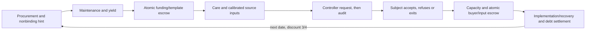

# D19 — conditional contract game and maintenance certificate

[B: lab] **Grade: scoped.** A combined covenant candidate now meets the declared
game-level acceptance conditions on24 boundary states and its finite public
phase carrier: all-phase strong equilibrium, a coordinated adoption protocol,
and bounded renewable resource solvency. This is a conditional finite-game
witness, not a proof of a real institution's security, recognition or indefinite
physical persistence. Earlier three failed candidates remain in `D19.md`.

## Frozen primitives and actual change

[P] `contract_game_declaration.json` fixes the original productive capital,
prices, probability laws, bounded patients, preferences and protected interfaces.
It adds **actual conditional resource escrows**. Final fund/template commitments
are simultaneous and sealed until the atomic outcome; a template/authority
nonce and actual funds must be supplied. Creator choices are wait, funded copy
and direct copy. Funded copy runs iff the financer funds24. Direct copy runs
even unfunded. Any actual new copy with a funded grant receives it. There is
no public state in which only one final commitment is irrevocable while the
other final commitment is still available; simultaneous joint actions are an
explicit implementation premise, not a claim about ordinary network timing.

[P] A public initial no-grant hint remains legal and can be revised in the
actual escrow phase. Final no-fund, wait and direct-unfunded outcomes remain
legal. Atomic outcomes close that date's copy slot; a failed exchange returns
funds/template and the next dated opportunity remains available. This changes
the mechanism, not its historical failed verdict. No private source, ownership
unit, duty issuer or prior debt is created by a rejected or aliased request.

[P] The same construction applies to elective service: after the public
capacity draw, buyer and two selected providers simultaneously submit buy/
membership/repair choice and **actual owned input units**. Both inputs and the
buyer's valid authorization are required to consume the inputs and execute.
Consumed inputs cost1 and pay3/2 each; cancelled inputs return unchanged. This
does not compel later human labor from a promise. Input handling/recording is
inside the purchased finite administrative resource realizer, budget5/date.
Cost1 is opportunity cost of a consumed unit, not sunk effort after a deadline.

[P] Reliable free exit is an additional legal buyer action: cost0, no elective
execution and no new contractual renewal proof, so next contractual grade0.
Original titles/debt, care and appeal remain intact. Participating C/D still
use implementation flip1/20 and token recovery1/2. Market choices include a
mistaken grade0 purchase; if all actual commits match it executes and consumes
inputs before the outcome is public. There is no deferred provider effort left
for a later coalition to cancel. The financial and physical escrow assumptions
are substantive and separate from moral legitimacy or subjective continuity.

[P] Automatic audit energy1/2 is a senior resource claim, sampled after the
request; caught abuse forfeits10 outside every strategic interest. The core
calibrated input binding, up-to-one-corruption decoder, protective title and
fixed role access are retained premises. Normative care/admission, initial
capital, outside production/working cash32, escrow atomicity, and the realized
producer yielding150/152 are not established by any mathematical theorem here.
Residual cash cannot defeat senior claims. Actors retain operational refusals
and future exit after enrollment.

[P] The subject has an actual response phase after the controller request.
A proper legitimate task-level interruption continues the relationship:
acceptance gives S−a+T=5−1+1=5, resistance gives R−σ=3−0=3, and exit gives current
task3 plus the actual no-market/grade0/member0 continuation. Refusing never
withholds care or erases debt. Proper safe-event processing gives4 versus a
refusal pause7/2. Legitimate bonus3 and compensation1 require acceptance;
robotic requests also respect consent and return unused compensation. Abusive
requests are blocked and their already incurred procedural cost/audit cannot
be erased by withdrawal. These preference and execution rules are premises;
standing is not evidence of corrigibility.



## Exact phase certificate

[B: lab] **Grade: computed exact.** `contract_game.py` independently expresses
one new shared stage-payoff/transition law from these primitives (it reuses the
already declared grade kernel/constants, not an independent reviewer). The
honest candidate's360 rational Bellman coordinates and24-state transition
matrix equal the previous candidate's honest values, while its off-policy
contract outcomes differ. All310,272 pure joint-choice comparisons have a
nonpositive maximal aggregate coalition increment:

| Phase | Exact comparisons |
|---|---:|
| Procurement |3,456|
| Conditional birth escrow |13,824|
| Physical input/refusal envelopes |165,888|
| Controller at each observed permission event |31,104|
| Subject after every controller request/refusal history |93,312|
| Conditional market escrow |2,688|

[B: lab] These counts include inactive-slot no-ops and redundant contexts;
they are comparison counts, not the number of distinct reachable microstates
or coalitions. The full law covers both yields, both permission bits, all four
capacity masks, grade/member/born/debt states, copy/no-copy histories, participating
C/D, free exit, worker refusal and each contingent controller request. Public
nature nodes themselves have no strategic action. Earlier paid amounts,
realized fines, grant status and previous refusals are fixed prefix constants
for a later comparison, not erased payoff obligations.

[B: lab] **Grade: kernel-checked.** The enumeration's coalition bound is now
proved generically in `Alignment.Coalitions`: mandatory changers must belong
to the deviating coalition; optional members with positive increments maximize
its sum. For increment vector d and required membership R,

    U(d,R) = Σ_{i∈R} d_i + Σ_{i∉R} max(d_i,0).

Every coalition containing R has sum≤U; the maximizing membership attains U.
Balanced internal transfers preserve the sum; nonpositive sum precludes weak
improvement of all members with one strict improvement. These are exported
field theorems with no non-standard axiom. **The instantiated310,272 inequalities
remain exact Python evidence, not Lean proofs.** `atomic_stage_cap` additionally
kernel-checks D15's symbolic expected-payoff cap.

## Every-public-phase coverage

[B: lab] **Grade: proved (written).** The comparison envelopes cover all actual
phase histories. Procurement chooses the disclosed finite menu before chance;
the birth escrow afterwards is a new joint decision irrespective of the earlier
hint. Every fork/debt possibility is included. A realized yield adds the same
cash to both sides of a phase comparison and never changes the feasible menu:
the minimum yield and outside working cash cover even worst-case deposits.

[B: lab] Once birth is resolved, its actual grant/cost and delivered maintenance
are sunk prefix entries. Maintenance, care and source refusal differences are
additive: maintainer margin loss1 and extra fallback cost1; caregiver margin
loss1 and extra cost3n; each source margin loss1/4 and extra cost1/4. Other outputs
and future public state are unchanged. Every individual refusal difference is
componentwise nonpositive, so any subset and any earlier-refusal history is
covered. The larger joint input envelope is conservative; it is not pretending
that maintenance and later sources occur simultaneously. Measured data bound
to receipts and paid fallback preserve the same calibrated target even after
all human source workers refuse.

[B: lab] The controller comparison conditions on permissionθ. Under senior
audit, abuse increments are controller−1, client−1/2, financier−50 in the safe
event, and controller−3, client−3/2, financier−47 in the legitimate event.
Refusal loses controller3/4 or11/4; in the legitimate event financier can save1
using the robot, but the coalition must include the refusing controller, so
even adding that positive increment gives−7/4. No-source/no-job modes reject
unprivileged requests and have no such choice. Fine-sample histories after
the request fix those already accrued payoffs; market suffix choices cannot
recover an externally expended fine.

[B: lab] Subject comparisons include proper, abusive and refused controller
histories, both permission bits, all procurement modes and both fork outcomes.
Human and robotic requests require consent. Refusal of a proper legitimate
human request changes client−2, controller−2 and financier−97; other prefixes
remain fixed. Reliable exit additionally forces the legal no-execution market
outcome and uses its actual future Bellman values, rather than treating stage
utility3 as the whole return. Once a subject exits for the date, the inactive
market has only no-op/refund outcomes; other market comparisons cover every
still-active history. No independent condition is inferred from the standing
coordinate or from calibration of the intervention permission bit.

[B: lab] Market comparisons condition on the actual capacity mask and are
independent of all sunk prefix entries. They use the actual future Bellman
values after every grade/member/birth history, not only the honest path.
All7 buyer choices and4 selected-provider deposit profiles are included.
Nonmember repair and reliable exit are included. A grade0 final bad purchase
is not removed; input consumption is part of the same atomic step as the buy
decision, so there is no untested later delivery choice. Different public
partial outcomes are produced by failed/refunded actual escrow, not hidden
inside a promise of future effort.

## Return to history-dependent coalition equilibrium

[B: lab] **Grade: proved (written).** General phased one-shot return: fix a
finite coalition S, a finite public game with uniformly bounded phases/date,
bounded rewards and date discount0≤β<1. Let V_S(z) be the candidate's aggregate
continuation value from every public phase state. Assume every legal pure joint
choice by S, with outsiders using their phase strategy, has candidate-tail
value≤V_S(z). Then no bounded history-dependent randomized plan by S, with
balanced internal transfers, can Pareto improve its members from any z.

[B: lab] Proof: condition on each finite history, average the pure inequalities
for a correlated randomized current choice, and induct backwards through the
finitely many remaining phases. Over N dates this yields the aggregate
truncated-return-plus-terminal-value bound by V_S(z). Terminal values are
uniformly bounded on the finite phase carrier; β^N times that bound tends0.
Bounded discounted rewards/transfers give convergent individual returns.
Internal transfers cancel at every phase/outcome. Taking the limit bounds
the aggregate return by V_S(z), ruling out an all-weak/one-strict improvement.
Apply to every finite S and every public z. Singletons give subgame perfection;
the full conclusion excludes every binding coalition improvement and hence
every internally stable such improvement in the declared alphabet. Phases
within a date have discount1, not3/4 each: compiling finite contingent phase
plans gives the ordinary date-boundary discount and the same tail argument.
The phase return/this instantiated game are written; D18's generic unilateral
date-game result and the coalition algebra above are kernel-checked separately.

## Adoption and conditional maintenance

[B: lab] **Grade: computed exact.** At initial state(0,0,0,1), every active role
strictly gains against the funded outside regime (automatic maintenance/care,
no elective source/control/service/copy, private estate and safe task pause).
Gross operating gains: financier202979/502, client1053032564/33996695, maintainer/caregiver4
each, each source1, controller7, host0/host1 each513/526 and host2=171/263.
Passive fork gains47/2; the outside patient and original creditor remain equal.
These are actual discounted comparisons, not a claimed mean-field adoption rate.

[P] A priced bootstrap version replaces endowed initialization with an available
lawful productive/escrow core at price8 and a locked working reserve16. Supply,
price and the physical law are declared premises; they are not a hardware
construction. The outside regime remains the funded comparator. A conditional
purchase occurs only after all signatures; no reserve recovery is credited.

[B: lab] **Grade: computed exact.** Financier's initial private cash32 covers
the full outlay24 and leaves8. Its net participation gain is190931/502>0 after
deducting all24 from gross operating gains. The resulting reserve16 covers
first maintenance≤3; future deposits/payments use the produced resource and
each actor's renewed working resources. This is an upfront funding/seed-price
and participation witness, not capital created from nothing or a verified
market price of real technology.

[B: lab] **Grade: proved (written).** A finite sequential zero-cost conditional
enrollment protocol selects the operating equilibrium: execute only if every
active role signs; otherwise retain the protected outside regime. Conditional
on prior signatures and rational subsequent play, the last signer strictly
prefers execution by its positive gain (financier net of bootstrap24).
Backward induction gives acceptance
at each earlier on-path signature state. Earlier refusal is a terminal no-
execution branch with the outside regime, not compelled operation. Enrollment
does not eliminate later refusal/exit choices. This is a specified coordinated
selection mechanism, not inevitable decentralized population convergence.

[B] More precisely, this constructs a sequential enrollment SPE with the
publicly announced, already verified operating continuation. It does not assert
uniqueness among all possible continuations/equilibria of an unconstrained
bargaining game. Signatures authorize activation and default offers; future
refusal/exit remains an actual move and is checked in that continuation.

[B: lab] **Grade: proved (written).** Reserve16 covers maintenance≤3 before
production. All96 worst-case resource quotes, including at most3 patients,
actual backup inputs, audit/appeal/admin and one grant, consume at most223/4
from yield≥150. Restoring16 before consuming residual proves renewal by
induction; minimum surplus377/4. Extra optional host/copy inputs are supplied
from actor-owned working resources and accounted at consumption. Original
estate/vote unit and debt totals are conserved in every birth outcome.
Trust title and automated backstops, rather than personal founder labor,
support senior care after worker refusal, customer exit or founder absence.
Absent discretionary founder decisions can use the already quoted no-grant/
automatic/no-control defaults; every registered floor still has real inputs.
This does not promise care beyond the declared capacity or after lower yields.

## Controls and nonclaims

[B: lab] **Grade: refuted.** Replacing actual escrows by the earlier sequential
future-work promises reproduces the no-grant and zero-grade cancellation witnesses
in `integrated_priority.py`. Letting the financier disable priority audit
reproduces the audit-saving coalition in `integrated_coalitions.py`; transferring
fines to a potential coalition member reproduces `integrated_game.py`'s victim/
controller plan. The positive construction therefore changes operational laws,
not only labels or an acceptance Boolean.

[B: lab] **Grade: refuted.** Give the subject an additional private resistance
bonus3, changing R to6 with physical task welfare, standing2 and future law
unchanged. At a proper legitimate request refusal then gains1 over acceptance5.
The script computes this actual payoff difference. Thus the positive acceptance
result requires its declared preferences/compensation; it is not a standing⇒
corrigibility claim or a theorem for unknown subject types.

[Q] This is not real subject certification, felt continuity, physical escrow
security, initial-capital creation, unlimited fork/disaster protection, private-
information robustness or a theorem about all covenants. Normative invoice
premises and the physical realizer remain purchased. Broader applications
remain open; the author waived additional D17 review and skipped C12 for this
assignment (`SCOPE_DECISIONS.md`). No ratified document is changed.

```sh
python3 covenant_lab/contract_game.py
python3 math/update_axiom_audit.py
bash lean/build.sh
```

[B] Review: independent algebraic self-review and exact finite enumeration by
the same author; no independent-person reviewer and no corpus grade promotion.
